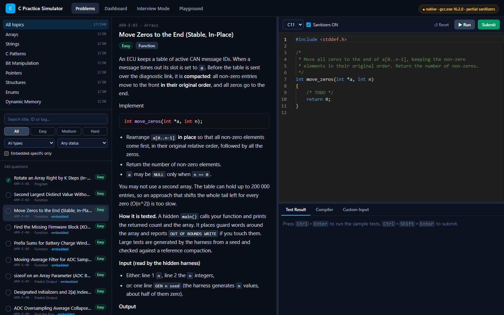
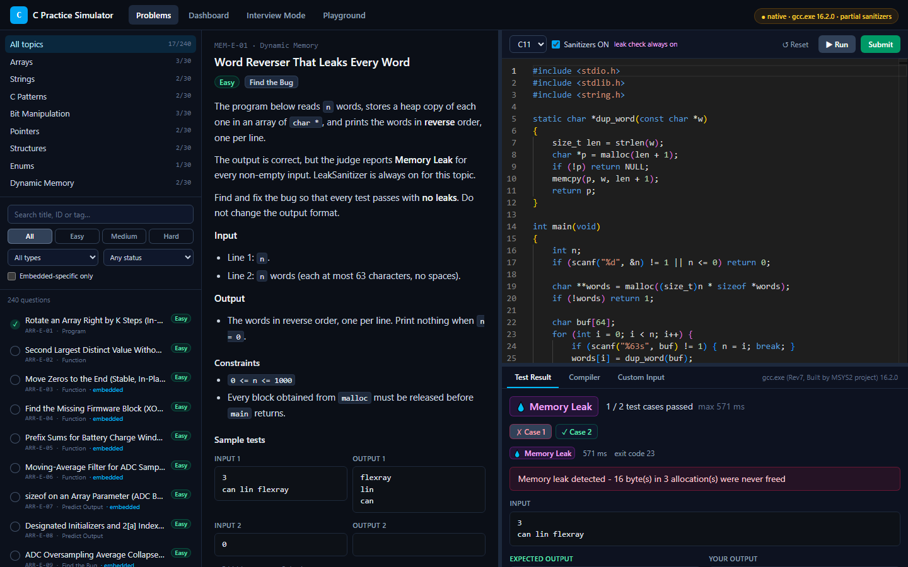

# C Practice Simulator

A LeetCode-style, fully local practice app for **embedded / automotive C interviews**. It has a real `gcc` judge with
AddressSanitizer, UndefinedBehaviorSanitizer and LeakSanitizer, and a bank of **240 verified questions**
(8 topics × 30, each topic 10 Easy / 10 Medium / 10 Hard).



| Memory-leak detection | Predict the output |
|---|---|
|  |  |
| **Dashboard** | **Playground** |
|  |  |

## Features

- **Real compiler judge.** Code is compiled with
  `gcc -std=c11 -Wall -Wextra -Werror=implicit-function-declaration -g -fsanitize=address,undefined -o prog main.c`
  and run against every test with a **2 s** time limit and a memory limit. Verdicts are
  `Accepted | Wrong Answer | Compile Error | Runtime Error | Time Limit Exceeded | Memory Leak`.
- **Toggles.** Sanitizers ON/OFF and a C99/C11 dropdown.
- **Leak detection.** A leak fails the test with *"Memory leak detected"* even when the output is correct. The
  **Dynamic Memory** topic always checks for leaks, even with sanitizers OFF.
- **Four question types.**
  - **CODE:** a full program, stdin to stdout.
  - **FUNCTION:** you write one function and a hidden `main()` harness calls it.
  - **PREDICT_OUTPUT:** type the exact output, or pick *Undefined Behavior* / *Compile Error*.
  - **FIND_THE_BUG:** buggy code is preloaded and you fix it.
- **Results panel.** Compile errors and warnings appear as squiggles in the editor and as clickable line links.
  Each failing test shows the sanitizer report (ASan, UBSan, LSan), stdout, stderr, exit code and time.
- **Run vs Submit.** **Run** uses the sample tests. **Submit** also runs the hidden tests, and the first failing
  hidden test is shown in full. **Custom input** runs your code on any stdin and compares it against the
  reference solution's output for that input.
- **Hints and solutions.** Up to 2 hints, revealed one at a time. *Show solution* unlocks after one attempt and
  includes an explanation (approach, time/space complexity, common mistakes, interview follow-ups).
- **Autosave.** Your code is saved per question, in localStorage and on the backend.
- **Sidebar.** Lists the 8 topics; filters by difficulty, type and status, plus an *Embedded-specific only*
  filter and search.
- **Dashboard.** Solved count per topic and per difficulty, current and longest streak, activity heatmap, the last
  10 submissions, and interview history.
- **Interview Mode.** Three random questions (1 Easy, 1 Medium, 1 Hard) from the topics you choose, a 45-minute
  timer, no hints, and a score out of 100 at the end (20/30/50 points, with partial credit for tests passed).
- **Playground.** A blank editor with stdin for free experimentation.
- **Shortcuts.** <kbd>Ctrl</kbd>+<kbd>Enter</kbd> = Run, <kbd>Ctrl</kbd>+<kbd>Shift</kbd>+<kbd>Enter</kbd> = Submit.

## Quick start

You need **Node.js ≥ 20.19** and **gcc**. The recommended setup is **Linux or WSL2**, which gives you the real ASan,
UBSan and LeakSanitizer.

### Linux / WSL2 (recommended)

```bash
# Windows only: install WSL2 + Ubuntu once, from an *administrator* PowerShell, then reboot:
#   wsl --install -d Ubuntu
# Then inside Ubuntu:
sudo apt update && sudo apt install -y build-essential          # gcc with libasan/libubsan/liblsan
curl -fsSL https://deb.nodesource.com/setup_22.x | sudo -E bash - && sudo apt install -y nodejs

cd ~ && cp -r "/mnt/c/Users/<you>/Documents/c simulator" c-simulator && cd c-simulator   # or git clone
npm install
npm run dev            # judge API on :3001 + web UI on http://localhost:5173
```

Open **http://localhost:5173** in your Windows browser (WSL2 forwards localhost).

Keep the project inside the Linux filesystem (`~/...`), not under `/mnt/c`. Builds and process spawning are
much faster there.

### Docker (optional, strongest sandbox)

If `docker info` works, the judge picks Docker automatically. On first start it pulls `gcc:latest` in the
background, and uses native gcc until the pull finishes. Every submission then runs in a throw-away container
with `--network none --memory=128m --pids-limit 64 --cpus 1`.

To force a mode, set `JUDGE_MODE=docker` or `JUDGE_MODE=native` (`npm run dev` uses `auto`).

### Windows without WSL (fallback)

```powershell
node scripts/setup_windows_toolchain.js           # portable MSYS2 gcc into .toolchain/ (no admin needed)
node scripts/setup_windows_toolchain.js --clang   # optional: clang + AddressSanitizer for Windows
npm install
npm run dev
```

MinGW gcc has **no ASan/LSan runtime**. On Windows the judge substitutes:

- UBSan in trap mode,
- `-fstack-protector-strong`,
- `-mno-ms-bitfields` (Linux struct layout),
- its own portable heap checker, [`judge-runtime/heapcheck.c`](judge-runtime/heapcheck.c). It detects leaks,
  double/invalid `free`, heap overflow (redzones) and write-after-free (quarantine poisoning).

The toolbar pill shows which mode is active.

### Production build

```bash
npm start          # builds the UI into dist/ and serves UI + API on http://localhost:3001
```

## How the judge works

| Step | What happens |
|---|---|
| Assemble | FUNCTION/FIND_THE_BUG questions with a hidden harness get your code inserted at `/*USER_CODE*/`. `#line` directives keep compiler errors and sanitizer stack traces pointing at **your** line numbers. |
| Compile | Exact judge flags (above) plus `-lm`, in a fresh temp directory (deleted afterwards) or a Docker container. |
| Run | Each test gets its stdin, a 2 s wall-clock limit (process-group kill), a 1 MiB stdout cap, and a memory limit: `ulimit -v 256 MB` natively without sanitizers, ASan `hard_rss_limit_mb` with sanitizers, or Docker `--memory=128m`. |
| Compare | CRLF→LF, trailing spaces on every line and trailing blank lines are ignored. **Leading spaces matter** (patterns!). |
| Verdict | TLE → Runtime Error (signal, ASan/UBSan report, non-zero exit) → Wrong Answer → Memory Leak → Accepted, decided per test. |

Sanitizer mode by platform:

| Platform | Sanitizers ON | Sanitizers OFF |
|---|---|---|
| Linux / WSL2 / Docker | `-fsanitize=address,undefined` (LSan included) | plain; Dynamic Memory adds `-fsanitize=leak` |
| Windows + MinGW gcc | UBSan trap + stack protector + heap checker | plain; Dynamic Memory adds the heap checker |
| Windows + clang (`CC=clang`) | ASan + UBSan + heap checker (leaks) | plain |

Environment variables: `PORT` (API, default 3001), `CC` (compiler), `JUDGE_MODE` (`auto|docker|native`),
`JUDGE_DOCKER_IMAGE` (default `gcc:latest`), `JUDGE_PARALLEL` (concurrent judge jobs), `CSIM_DATA_DIR`
(progress storage, default `data/`).

## The question bank

| Topic | Questions | Easy / Medium / Hard | Embedded-tagged |
|---|---|---|---|
<!-- BANK_TABLE -->

Every topic has about 18 CODE/FUNCTION, 6 PREDICT_OUTPUT and 6 FIND_THE_BUG questions. At least 30% are
embedded/automotive-flavoured, for example:

- UART ring buffers, ADC filters, sensor calibration lookup tables;
- CAN signal packing (Intel/Motorola), J1939 decoding, CRC-8 SAE J1850 and CRC-16-CCITT;
- memory-mapped registers through `volatile` pointers, ISR dispatch tables;
- UDS request parsing and session state machines, DTC status bytes;
- fixed-block memory pools and a `my_malloc` with coalescing.

Each question follows the strict JSON schema in `questions/<topic>.json`. Every CODE, FUNCTION and FIND_THE_BUG
question has at least 2 sample and 5 hidden tests covering edge cases (n = 0/1, max size, negatives,
`INT_MIN`/`INT_MAX`, all-equal values, NULL, ...).

### Adding a question

Questions are authored as plain-text `.q` files in `questions_src/<topic>/` (no JSON escaping of C code), and
`npm run build:questions` generates `questions/*.json`. The full format and rules are in
**[docs/AUTHORING.md](docs/AUTHORING.md)**.

```bash
npm run q -- new pointers PTR-H-11 FUNCTION "My new question"   # scaffold
npm run q -- fill questions_src/pointers/PTR-H-11.q             # fill <<AUTO>> outputs from the solution
npm run q -- check questions_src/pointers/PTR-H-11.q            # validate one file
npm run validate                                                 # validate the whole bank
```

## Validation

`scripts/validate_questions.js` uses the **same judge code as the app**. For every question it:

1. checks the JSON schema and unique IDs, 30 questions (10/10/10) per topic, the type mix, and ≥ 30% `embedded`;
2. lints for portability (no `long`, no POSIX-only calls hidden by `-std=c11`, no `%p`, no `rand`, ...);
3. compiles `solution_code` (inside the harness for FUNCTION) with the exact judge flags and **requires zero
   warnings**;
4. runs **all** sample + hidden tests and requires 100% Accepted, with no sanitizer, UB or leak reports and nothing
   on stderr;
5. for **FIND_THE_BUG**, requires that the buggy starter code compiles and **fails at least one test**;
6. for **PREDICT_OUTPUT**, compiles the snippet and requires its real output to equal `predict_answer`. For
   *Compile Error* answers it requires that compilation fails;
7. checks that CODE/FUNCTION starter templates compile.

Final validator output:

```
<!-- VALIDATOR_OUTPUT -->
```

<!-- VALIDATION_NOTES -->

## Project layout

```
client/                 React + Vite + TypeScript + Tailwind + Monaco UI
server/                 Express API (index.js), progress store, question loader
server/judge/           toolchain detection + compile/run/verdict engine (shared with the validator)
judge-runtime/          portable heap checker used when LeakSanitizer is unavailable
questions/              the bank: one strict-schema JSON file per topic (generated, committed)
questions_src/          .q sources of every question
scripts/                validate_questions.js, build_questions.js, qtool.js, setup_windows_toolchain.js, screenshots.js
docs/                   AUTHORING.md, screenshots
data/                   your progress (progress.json, git-ignored)
```

## Decisions and assumptions

<!-- DECISIONS -->

## Troubleshooting

- **"no compiler found"** in the toolbar: install gcc (`sudo apt install build-essential`), or set `CC=/path/to/gcc`.
- **The pill says "partial sanitizers"**: you are on a toolchain without ASan/LSan (MinGW, or WSL1). Use WSL2/Linux
  for the real thing; the portable heap checker still catches leaks and double frees.
- **Port already in use**: `PORT=3002 npm run dev` changes the API port (Vite proxies to it automatically). The
  UI port 5173 is fixed in `vite.config.ts`.
- **Reset progress**: stop the server and delete `data/progress.json`.
