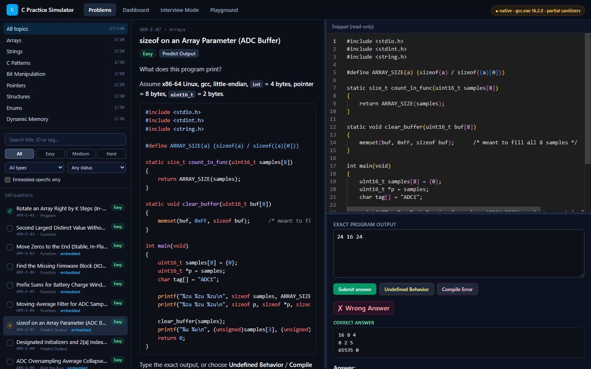
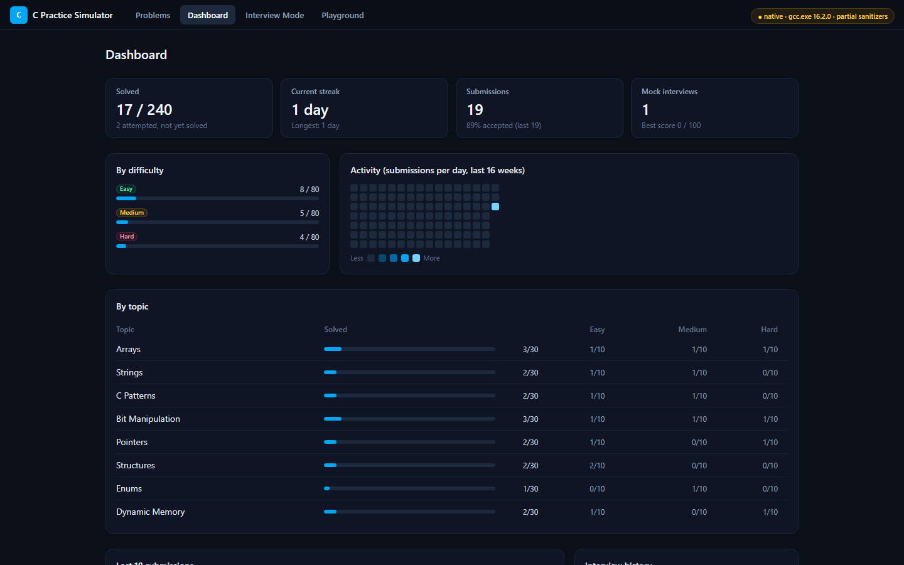
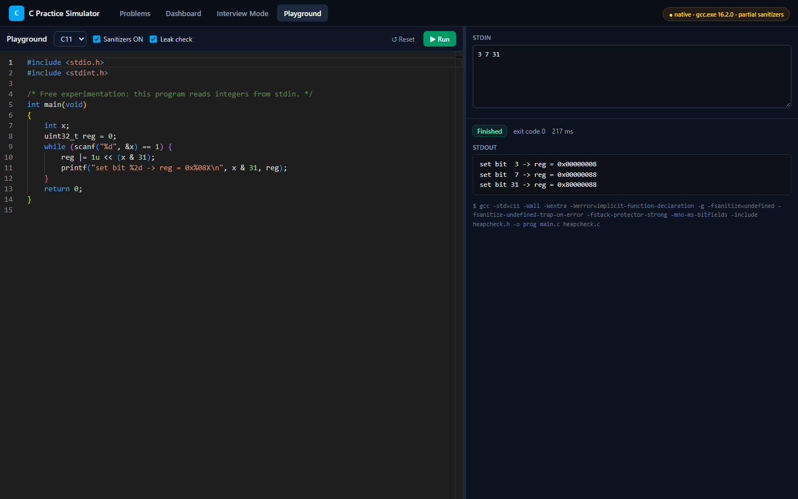

# C Practice Simulator

A LeetCode-style, fully local practice app for **embedded / automotive C interviews**. It has a real `gcc` judge with
AddressSanitizer, UndefinedBehaviorSanitizer and LeakSanitizer, and a bank of **240 verified questions**
(8 topics × 30, each topic 10 Easy / 10 Medium / 10 Hard).


| Memory-leak detection | Predict the output |
|---|---|
|  |  |
| **Dashboard** | **Playground** |
|  |  |

## Features

- **Real compiler judge.** Code is compiled with
  `gcc -std=c11 -Wall -Wextra -Werror=implicit-function-declaration -g -fsanitize=address,undefined -o prog main.c`
  and run against every test with a **2 s** time limit and a memory limit. Verdicts are
  `Accepted | Wrong Answer | Compile Error | Runtime Error | Time Limit Exceeded | Memory Leak`.
- **Toggles.** Sanitizers ON/OFF and a C99/C11 dropdown.
- **Leak detection.** A leak fails the test with *"Memory leak detected"* even when the output is correct. The
  **Dynamic Memory** topic always checks for leaks, even with sanitizers OFF.
- **Four question types.**
  - **CODE:** a full program, stdin to stdout.
  - **FUNCTION:** you write one function and a hidden `main()` harness calls it.
  - **PREDICT_OUTPUT:** type the exact output, or pick *Undefined Behavior* / *Compile Error*.
  - **FIND_THE_BUG:** buggy code is preloaded and you fix it.
- **Results panel.** Compile errors and warnings appear as squiggles in the editor and as clickable line links.
  Each failing test shows the sanitizer report (ASan, UBSan, LSan), stdout, stderr, exit code and time.
- **Run vs Submit.** **Run** uses the sample tests. **Submit** also runs the hidden tests, and the first failing
  hidden test is shown in full. **Custom input** runs your code on any stdin and compares it against the
  reference solution's output for that input.
- **Hints and solutions.** Up to 2 hints, revealed one at a time. *Show solution* unlocks after one attempt and
  includes an explanation (approach, time/space complexity, common mistakes, interview follow-ups).
- **Autosave.** Your code is saved per question, in localStorage and on the backend.
- **Sidebar.** Lists the 8 topics; filters by difficulty, type and status, plus an *Embedded-specific only*
  filter and search.
- **Dashboard.** Solved count per topic and per difficulty, current and longest streak, activity heatmap, the last
  10 submissions, and interview history.
- **Interview Mode.** Three random questions (1 Easy, 1 Medium, 1 Hard) from the topics you choose, a 45-minute
  timer, no hints, and a score out of 100 at the end (20/30/50 points, with partial credit for tests passed).
- **Playground.** A blank editor with stdin for free experimentation.
- **Shortcuts.** <kbd>Ctrl</kbd>+<kbd>Enter</kbd> = Run, <kbd>Ctrl</kbd>+<kbd>Shift</kbd>+<kbd>Enter</kbd> = Submit.

## Quick start

You need **Node.js ≥ 20.19** and **gcc**. The recommended setup is **Linux or WSL2**, which gives you the real ASan,
UBSan and LeakSanitizer.

### Linux / WSL2 (recommended)

```bash
# Windows only: install WSL2 + Ubuntu once, from an *administrator* PowerShell, then reboot:
#   wsl --install -d Ubuntu
# Then inside Ubuntu:
sudo apt update && sudo apt install -y build-essential          # gcc with libasan/libubsan/liblsan
curl -fsSL https://deb.nodesource.com/setup_22.x | sudo -E bash - && sudo apt install -y nodejs

cd ~ && cp -r "/mnt/c/Users/<you>/Documents/c simulator" c-simulator && cd c-simulator   # or git clone
npm install
npm run dev            # judge API on :3001 + web UI on http://localhost:5173
```

Open **http://localhost:5173** in your Windows browser (WSL2 forwards localhost).

Keep the project inside the Linux filesystem (`~/...`), not under `/mnt/c`. Builds and process spawning are
much faster there.

### Docker (optional, strongest sandbox)

If `docker info` works, the judge picks Docker automatically. On first start it pulls `gcc:latest` in the
background, and uses native gcc until the pull finishes. Every submission then runs in a throw-away container
with `--network none --memory=128m --pids-limit 64 --cpus 1`.

To force a mode, set `JUDGE_MODE=docker` or `JUDGE_MODE=native` (`npm run dev` uses `auto`).

### Windows without WSL (fallback)

```powershell
node scripts/setup_windows_toolchain.js           # portable MSYS2 gcc into .toolchain/ (no admin needed)
node scripts/setup_windows_toolchain.js --clang   # optional: clang + AddressSanitizer for Windows
npm install
npm run dev
```

On the Windows machine this repo was built on, the portable Node.js lives in the git-ignored `.toolchain\node`, and
gcc/clang live in `.toolchain\msys64`. To use that Node from PowerShell without installing anything, run this
first:

```powershell
$env:Path = "$PWD\.toolchain\node;$env:Path"   # current terminal only
npm run dev
```

MinGW gcc has **no ASan/LSan runtime**. On Windows the judge substitutes:

- UBSan in trap mode,
- `-fstack-protector-strong`,
- `-mno-ms-bitfields` (Linux struct layout),
- its own portable heap checker, [`judge-runtime/heapcheck.c`](judge-runtime/heapcheck.c). It detects leaks,
  double/invalid `free`, heap overflow (redzones) and write-after-free (quarantine poisoning).

The toolbar pill shows which mode is active.

### Production build

```bash
npm start          # builds the UI into dist/ and serves UI + API on http://localhost:3001
```

## How the judge works

| Step | What happens |
|---|---|
| Assemble | FUNCTION/FIND_THE_BUG questions with a hidden harness get your code inserted at `/*USER_CODE*/`. `#line` directives keep compiler errors and sanitizer stack traces pointing at **your** line numbers. |
| Compile | Exact judge flags (above) plus `-lm`, in a fresh temp directory (deleted afterwards) or a Docker container. |
| Run | Each test gets its stdin, a 2 s wall-clock limit (process-group kill), a 1 MiB stdout cap, and a memory limit: `ulimit -v 256 MB` natively without sanitizers, ASan `hard_rss_limit_mb` with sanitizers, or Docker `--memory=128m`. |
| Compare | CRLF→LF, trailing spaces on every line and trailing blank lines are ignored. **Leading spaces matter** (patterns!). |
| Verdict | TLE → Runtime Error (signal, ASan/UBSan report, non-zero exit) → Wrong Answer → Memory Leak → Accepted, decided per test. |

Sanitizer mode by platform:

| Platform | Sanitizers ON | Sanitizers OFF |
|---|---|---|
| Linux / WSL2 / Docker | `-fsanitize=address,undefined` (LSan included) | plain; Dynamic Memory adds `-fsanitize=leak` |
| Windows + MinGW gcc | UBSan trap + stack protector + heap checker | plain; Dynamic Memory adds the heap checker |
| Windows + clang (`CC=clang`) | ASan + UBSan + heap checker (leaks) | plain |

Environment variables: `PORT` (API, default 3001), `CC` (compiler), `JUDGE_MODE` (`auto|docker|native`),
`JUDGE_DOCKER_IMAGE` (default `gcc:latest`), `JUDGE_PARALLEL` (concurrent judge jobs), `CSIM_DATA_DIR`
(progress storage, default `data/`).

## The question bank

| Topic | Questions | Easy / Medium / Hard | Embedded-tagged |
|---|---|---|---|
| Arrays | 30 | 10/10/10 | 22 |
| Strings | 30 | 10/10/10 | 20 |
| C Patterns | 30 | 10/10/10 | 12 |
| Bit Manipulation | 30 | 10/10/10 | 21 |
| Pointers | 30 | 10/10/10 | 15 |
| Structures | 30 | 10/10/10 | 27 |
| Enums | 30 | 10/10/10 | 25 |
| Dynamic Memory | 30 | 10/10/10 | 19 |
| **Total** | **240** | **80/80/80** | **161** |

Every topic has about 18 CODE/FUNCTION, 6 PREDICT_OUTPUT and 6 FIND_THE_BUG questions. At least 30% are
embedded/automotive-flavoured, for example:

- UART ring buffers, ADC filters, sensor calibration lookup tables;
- CAN signal packing (Intel/Motorola), J1939 decoding, CRC-8 SAE J1850 and CRC-16-CCITT;
- memory-mapped registers through `volatile` pointers, ISR dispatch tables;
- UDS request parsing and session state machines, DTC status bytes;
- fixed-block memory pools and a `my_malloc` with coalescing.

Each question follows the strict JSON schema in `questions/<topic>.json`. Every CODE, FUNCTION and FIND_THE_BUG
question has at least 2 sample and 5 hidden tests covering edge cases (n = 0/1, max size, negatives,
`INT_MIN`/`INT_MAX`, all-equal values, NULL, ...).

### Adding a question

Questions are authored as plain-text `.q` files in `questions_src/<topic>/` (no JSON escaping of C code), and
`npm run build:questions` generates `questions/*.json`. The full format and rules are in
**[docs/AUTHORING.md](docs/AUTHORING.md)**.

```bash
npm run q -- new pointers PTR-H-11 FUNCTION "My new question"   # scaffold
npm run q -- fill questions_src/pointers/PTR-H-11.q             # fill <<AUTO>> outputs from the solution
npm run q -- check questions_src/pointers/PTR-H-11.q            # validate one file
npm run validate                                                 # validate the whole bank
```

## Validation

`scripts/validate_questions.js` uses the **same judge code as the app**. For every question it:

1. checks the JSON schema and unique IDs, 30 questions (10/10/10) per topic, the type mix, and ≥ 30% `embedded`;
2. lints for portability (no `long`, no POSIX-only calls hidden by `-std=c11`, no `%p`, no `rand`, ...);
3. compiles `solution_code` (inside the harness for FUNCTION) with the exact judge flags and **requires zero
   warnings**;
4. runs **all** sample + hidden tests and requires 100% Accepted, with no sanitizer, UB or leak reports and nothing
   on stderr;
5. for **FIND_THE_BUG**, requires that the buggy starter code compiles and **fails at least one test**;
6. for **PREDICT_OUTPUT**, compiles the snippet and requires its real output to equal `predict_answer`. For
   *Compile Error* answers it requires that compilation fails;
7. checks that CODE/FUNCTION starter templates compile.

Final validator output:

```
$ npm run validate
C Practice Simulator - question bank validator
  toolchain : gcc.exe (Rev7, Built by MSYS2 project) 16.2.0 [native, x86_64-w64-mingw32]
  sanitizers: UBSan (trap mode) + portable heap checker (leaks, double/invalid free, heap overflow, write-after-free) + stack protector
  command   : gcc -std=c11 -Wall -Wextra -Werror=implicit-function-declaration -g -fsanitize=undefined -fsanitize-undefined-trap-on-error -fstack-protector-strong -mno-ms-bitfields -include heapcheck.h -o prog main.c heapcheck.c

...

Bank summary:
  Arrays             30  E/M/H 10/10/10  CODE 3 FUNCTION 15 PREDICT 6 BUG 6  embedded 22
  Strings            30  E/M/H 10/10/10  CODE 5 FUNCTION 13 PREDICT 6 BUG 6  embedded 20
  C Patterns         30  E/M/H 10/10/10  CODE 12 FUNCTION 6 PREDICT 6 BUG 6  embedded 12
  Bit Manipulation   30  E/M/H 10/10/10  CODE 3 FUNCTION 15 PREDICT 6 BUG 6  embedded 21
  Pointers           30  E/M/H 10/10/10  CODE 0 FUNCTION 18 PREDICT 6 BUG 6  embedded 15
  Structures         30  E/M/H 10/10/10  CODE 2 FUNCTION 16 PREDICT 6 BUG 6  embedded 27
  Enums              30  E/M/H 10/10/10  CODE 7 FUNCTION 11 PREDICT 6 BUG 6  embedded 25
  Dynamic Memory     30  E/M/H 10/10/10  CODE 2 FUNCTION 16 PREDICT 6 BUG 6  embedded 19

Time: 174.1 s
240/240 questions valid
```

<details>
<summary>Full per-question output (240 lines)</summary>

```
[Arrays]
  PASS  ARR-E-01  CODE           Rotate an Array Right by K Steps (In-Place)
  PASS  ARR-E-02  FUNCTION       Second Largest Distinct Value Without Sentinels
  PASS  ARR-E-03  FUNCTION       Move Zeros to the End (Stable, In-Place)
  PASS  ARR-E-04  FUNCTION       Find the Missing Firmware Block (XOR Trick)
  PASS  ARR-E-05  FUNCTION       Prefix Sums for Battery Charge Window Queries
  PASS  ARR-E-06  FUNCTION       Moving-Average Filter for ADC Samples
  PASS  ARR-E-07  PREDICT_OUTPUT sizeof on an Array Parameter (ADC Buffer)
  PASS  ARR-E-08  PREDICT_OUTPUT Designated Initializers and 2[a] Indexing
  PASS  ARR-E-09  FIND_THE_BUG   ADC Oversampling Average Collapses Near Full Scale
  PASS  ARR-E-10  FIND_THE_BUG   CAN DLC Histogram With a Mis-Sized Counter Array
  PASS  ARR-M-01  FUNCTION       Maximum Subarray Sum With Its Bounds (Kadane)
  PASS  ARR-M-02  FUNCTION       Count Pair Sums in a Sorted Array (Two Pointers)
  PASS  ARR-M-03  FUNCTION       Partition DTC Records by Severity (Dutch National Flag)
  PASS  ARR-M-04  CODE           Majority Vote of Redundant Channels (Boyer-Moore)
  PASS  ARR-M-05  FUNCTION       Rotate a Square Framebuffer 90 Degrees In Place
  PASS  ARR-M-06  FUNCTION       Command Dispatcher With an Array of Function Pointers
  PASS  ARR-M-07  PREDICT_OUTPUT a vs &a vs &a[0] Pointer Arithmetic
  PASS  ARR-M-08  PREDICT_OUTPUT Signed vs Unsigned Traps in Array Index Math
  PASS  ARR-M-09  FIND_THE_BUG   In-Place Merge of Two ECU Event Logs Loses Entries
  PASS  ARR-M-10  FIND_THE_BUG   Binary Search in the Fault Log Triggers a Watchdog Reset
  PASS  ARR-H-01  FUNCTION       UART RX Ring Buffer Without a Count Variable
  PASS  ARR-H-02  FUNCTION       Sliding-Window Peak-to-Peak With Monotonic Deques
  PASS  ARR-H-03  FUNCTION       NTC Calibration Lookup Table With Linear Interpolation
  PASS  ARR-H-04  FUNCTION       De-interleave a DMA Audio Buffer In Place (Cycle-Leader Transpose)
  PASS  ARR-H-05  FUNCTION       Lowest Free Handle ID in O(n) Time and O(1) Memory
  PASS  ARR-H-06  CODE           Stuck-Sensor and Short-Circuit Detection Across ADC Channels
  PASS  ARR-H-07  PREDICT_OUTPUT Walking a 2D Sensor Grid Through Row 0
  PASS  ARR-H-08  PREDICT_OUTPUT Pointer-to-Row Arithmetic and sizeof on a VLA Type
  PASS  ARR-H-09  FIND_THE_BUG   Median Filter That Corrupts Its Own Sample History
  PASS  ARR-H-10  FIND_THE_BUG   Pre-Trigger Snapshot From a Circular Sample Buffer

[Strings]
  PASS  STR-E-01  FUNCTION       Bare-Metal my_strlen, my_strcpy and my_strcat
  PASS  STR-E-02  FUNCTION       my_strcmp and my_strncmp with Correct Byte Ordering
  PASS  STR-E-03  CODE           Palindrome Check Ignoring Case and Punctuation
  PASS  STR-E-04  CODE           Anagram Check with a Frequency Table
  PASS  STR-E-05  CODE           First Non-Repeating Character in a Log Token
  PASS  STR-E-06  FUNCTION       Remove Duplicate Characters In Place
  PASS  STR-E-07  PREDICT_OUTPUT sizeof vs strlen on Arrays, Pointers and Literals
  PASS  STR-E-08  PREDICT_OUTPUT Writing Through a Pointer to a String Literal
  PASS  STR-E-09  FIND_THE_BUG   DTC Tag Builder with a Heap Overflow
  PASS  STR-E-10  FIND_THE_BUG   Cluster Display Text with Stale Characters
  PASS  STR-M-01  FUNCTION       Robust my_atoi with Overflow Clamping and Error Code
  PASS  STR-M-02  FUNCTION       my_itoa for Any Base from 2 to 36
  PASS  STR-M-03  FUNCTION       Reverse the Words of a Sentence In Place
  PASS  STR-M-04  FUNCTION       In-Place Run-Length Compression (aaabb to a3b2)
  PASS  STR-M-05  FUNCTION       Hex String to Byte Array and Back (UDS Request Parser)
  PASS  STR-M-06  FUNCTION       Implement my_strtok with Hidden Static State
  PASS  STR-M-07  PREDICT_OUTPUT Walking a String with *p++, (*p)++ and *++p
  PASS  STR-M-08  PREDICT_OUTPUT Missing Comma in a Bus-Name Table
  PASS  STR-M-09  FIND_THE_BUG   my_strstr Misses Matches After a Partial Match
  PASS  STR-M-10  FIND_THE_BUG   ECU Identification Table with Run-On Fields
  PASS  STR-H-01  CODE           NMEA $GPGGA Parser with Checksum Validation
  PASS  STR-H-02  FUNCTION       Parse a Modem AT+CSQ Response from a UART Buffer
  PASS  STR-H-03  FUNCTION       Parse a KEY=VALUE; Configuration String into a Fixed Table
  PASS  STR-H-04  FUNCTION       Overflow-Safe DTC Report Formatting with snprintf
  PASS  STR-H-05  CODE           Validate a VIN with the ISO 3779 Check Digit
  PASS  STR-H-06  FUNCTION       Wildcard Filter with ? and * for a Diagnostic Shell
  PASS  STR-H-07  PREDICT_OUTPUT Plain char Bytes in a Checksum, a Compare and a Shift
  PASS  STR-H-08  PREDICT_OUTPUT Unsigned strlen Arithmetic and strcmp Truthiness
  PASS  STR-H-09  FIND_THE_BUG   Base64 Decoder That Crashes on Non-ASCII Payloads
  PASS  STR-H-10  FIND_THE_BUG   CAN Gateway Routing Table Loses Every Route but the First

[C Patterns]
  PASS  PAT-E-01  CODE           Centered Star Pyramid
  PASS  PAT-E-02  CODE           Floyd's Triangle with Aligned Columns
  PASS  PAT-E-03  CODE           Alphabet Palindrome Pyramid
  PASS  PAT-E-04  FUNCTION       Register as an LED Strip
  PASS  PAT-E-05  CODE           LCD Checkerboard Test Pattern
  PASS  PAT-E-06  FUNCTION       Battery Gauge Icon for a Cluster Display
  PASS  PAT-E-07  PREDICT_OUTPUT break and continue in a Nested Star Loop
  PASS  PAT-E-08  PREDICT_OUTPUT putchar with Character Arithmetic
  PASS  PAT-E-09  FIND_THE_BUG   Right-Aligned Number Staircase Off by One
  PASS  PAT-E-10  FIND_THE_BUG   0-1 Triangle with a Broken Toggle
  PASS  PAT-M-01  CODE           Hollow Diamond from Its Width
  PASS  PAT-M-02  CODE           Number Butterfly
  PASS  PAT-M-03  CODE           Zig-Zag Rail Pattern of a String
  PASS  PAT-M-04  CODE           Number Hourglass with Multi-Digit Alignment
  PASS  PAT-M-05  CODE           Concentric Squares Number Pattern
  PASS  PAT-M-06  FUNCTION       Render a 5x7 Dot-Matrix Glyph from a Font Table
  PASS  PAT-M-07  PREDICT_OUTPUT printf Return Values and Star Widths
  PASS  PAT-M-08  PREDICT_OUTPUT Unsigned Countdown and a Loop That Never Runs
  PASS  PAT-M-09  FIND_THE_BUG   Pascal's Triangle That Breaks After Row 30
  PASS  PAT-M-10  FIND_THE_BUG   Column Ruler That Hangs on Wide Displays
  PASS  PAT-H-01  CODE           Window into a Huge Spiral Matrix
  PASS  PAT-H-02  FUNCTION       Seven-Segment Display Driver with Overflow Indicator
  PASS  PAT-H-03  FUNCTION       Vertical Bargraph of ADC Channels
  PASS  PAT-H-04  FUNCTION       Register Bit-Field Map Dump
  PASS  PAT-H-05  CODE           UART Frame Timing Diagram
  PASS  PAT-H-06  CODE           Multi-Channel PWM Waveform with Phase Shift
  PASS  PAT-H-07  PREDICT_OUTPUT Comma Operator and Post-Increment in Loop Conditions
  PASS  PAT-H-08  PREDICT_OUTPUT Number Pyramid with a Hidden Sequencing Trap
  PASS  PAT-H-09  FIND_THE_BUG   CAN Payload Dump with Wrong Decimals and Checksum
  PASS  PAT-H-10  FIND_THE_BUG   Bootloader Progress Bar That Corrupts the Heap

[Bit Manipulation]
  PASS  BIT-E-01  FUNCTION       SET_BIT, CLEAR_BIT, TOGGLE_BIT and CHECK_BIT Register Macros
  PASS  BIT-E-02  FUNCTION       Count Set Bits Two Ways (Kernighan and Lookup Table)
  PASS  BIT-E-03  FUNCTION       Power-of-Two Check, Lowest Set Bit and Align-Up
  PASS  BIT-E-04  FUNCTION       Swap Nibbles and Swap Byte Order (16 and 32 Bit)
  PASS  BIT-E-05  CODE           Find the Only Non-Repeating Value with XOR
  PASS  BIT-E-06  FUNCTION       Gray Code Encode and Decode for an Absolute Encoder
  PASS  BIT-E-07  PREDICT_OUTPUT Operator Precedence Traps in Bit Tests
  PASS  BIT-E-08  PREDICT_OUTPUT Integer Promotion of uint8_t with ~ and <<
  PASS  BIT-E-09  FIND_THE_BUG   XOR Swap Byte Reverser That Zeroes a Byte
  PASS  BIT-E-10  FIND_THE_BUG   GPIO Driver Mode Field Read-Modify-Write Bug
  PASS  BIT-M-01  FUNCTION       Reverse the Bits of a uint32_t and Reflect an N-Bit Field
  PASS  BIT-M-02  FUNCTION       Rotate Left and Right by Any Count Without Undefined Behavior
  PASS  BIT-M-03  FUNCTION       Parity by XOR Folding and the LIN Protected Identifier
  PASS  BIT-M-04  FUNCTION       Sign-Extend an N-Bit Two's Complement Sensor Value
  PASS  BIT-M-05  FUNCTION       FIELD_MASK, READ_FIELD and WRITE_FIELD Macros Done Right
  PASS  BIT-M-06  FUNCTION       CRC-8 SAE J1850 for AUTOSAR E2E Protection
  PASS  BIT-M-07  PREDICT_OUTPUT Right Shift of Signed vs Unsigned Values
  PASS  BIT-M-08  PREDICT_OUTPUT Sign Extension of a Plain char UART Buffer
  PASS  BIT-M-09  FIND_THE_BUG   Overflow Check That Is Itself Undefined Behavior
  PASS  BIT-M-10  FIND_THE_BUG   Big-Endian Frame Parser With an Overflowing Byte Shift
  PASS  BIT-H-01  FUNCTION       Unpack a CAN Signal (Intel and Motorola Byte Order)
  PASS  BIT-H-02  FUNCTION       Pack a CAN Signal Into a Payload (Intel and Motorola)
  PASS  BIT-H-03  FUNCTION       Table-Driven CRC-16/CCITT-FALSE With Streaming Updates
  PASS  BIT-H-04  CODE           Decode and Encode J1939 29-Bit CAN Identifiers
  PASS  BIT-H-05  FUNCTION       Saturating uint8 and int16 Arithmetic With a Q15 Multiply
  PASS  BIT-H-06  CODE           CAN Bit Stuffing and Destuffing on a Packed Bit Stream
  PASS  BIT-H-07  PREDICT_OUTPUT Full-Width Mask Built With an Unsigned Shift
  PASS  BIT-H-08  PREDICT_OUTPUT Bit-Field Register Overlay With a Plain int Field
  PASS  BIT-H-09  FIND_THE_BUG   UART Ring Buffer With Free-Running uint8_t Indices
  PASS  BIT-H-10  FIND_THE_BUG   Lost Interrupts on a Write-1-to-Clear Pending Register

[Pointers]
  PASS  PTR-E-01  FUNCTION       Swap Two Integers Through Pointers (Alias- and NULL-Safe)
  PASS  PTR-E-02  FUNCTION       Reverse a Half-Open Range with Two Pointers
  PASS  PTR-E-03  PREDICT_OUTPUT const int * vs int * const vs int const *
  PASS  PTR-E-04  PREDICT_OUTPUT Pointer Walk: *p++ vs (*p)++ vs ++*p vs *++p
  PASS  PTR-E-05  FIND_THE_BUG   ADC Moving-Average Filter Averages Half the Window
  PASS  PTR-E-06  FIND_THE_BUG   Cluster Debug Labels Crash When Upper-Cased
  PASS  PTR-E-07  FUNCTION       Detect Endianness and Dump an Object's Bytes
  PASS  PTR-E-08  FUNCTION       Implement my_memcpy and my_memset for a Bare-Metal Target
  PASS  PTR-E-09  FUNCTION       Return Min and Max Through Pointer-to-Pointer Out-Parameters
  PASS  PTR-E-10  FUNCTION       Sum a Raw Sensor Buffer Through a void Pointer
  PASS  PTR-M-01  FUNCTION       Implement my_memmove (Overlap-Safe Copy)
  PASS  PTR-M-02  FUNCTION       qsort an Array of String Pointers (Length, Then Alphabetical)
  PASS  PTR-M-03  FUNCTION       Generic Swap and Reverse with void Pointers and Element Size
  PASS  PTR-M-04  FUNCTION       Clipped Rectangle Fill in a Padded Framebuffer (Stride vs Width)
  PASS  PTR-M-05  PREDICT_OUTPUT Array of Pointers vs Pointer to Array
  PASS  PTR-M-06  PREDICT_OUTPUT The &a + 1 Trick, Pointer Difference Units and a char View of int
  PASS  PTR-M-07  FIND_THE_BUG   Fixed-Point Temperature Formatter Returns a Dead Buffer
  PASS  PTR-M-08  FIND_THE_BUG   qsort Comparator Breaks on Extreme Sensor Offsets
  PASS  PTR-M-09  FUNCTION       Event Notification Service with Callbacks and void* Context
  PASS  PTR-M-10  FUNCTION       Linked-List Insert and Remove-All with a Pointer to Pointer
  PASS  PTR-H-01  FUNCTION       UART Driver over Memory-Mapped Registers (volatile, RMW, W1C)
  PASS  PTR-H-02  FUNCTION       Debug-Shell Command Dispatcher with a Function-Pointer Table
  PASS  PTR-H-03  FUNCTION       Simulated Interrupt Vector Table with Priorities and Tail-Chaining
  PASS  PTR-H-04  PREDICT_OUTPUT Triple-Pointer Puzzle over a Table of ECU Names
  PASS  PTR-H-05  PREDICT_OUTPUT NULL, Wild or Dangling? A Guarded Pointer to a Freed CAN Frame
  PASS  PTR-H-06  FIND_THE_BUG   DMA Channel Registers Land in the Wrong Channel
  PASS  PTR-H-07  FIND_THE_BUG   CAN Trace Analyzer Keeps Pointers into a Growing Array
  PASS  PTR-H-08  FUNCTION       RTOS Software Timers on an Intrusive List with container_of
  PASS  PTR-H-09  FUNCTION       Fixed-Block Memory Pool with an Embedded Free List
  PASS  PTR-H-10  FUNCTION       Zero-Copy TLV Parser That Never Reads Past the Buffer

[Structures]
  PASS  STC-E-01  PREDICT_OUTPUT Padding in a Telemetry Frame Struct
  PASS  STC-E-02  PREDICT_OUTPUT Struct by Value vs Array by Pointer
  PASS  STC-E-03  FUNCTION       ADC Sample Statistics Returned as a Struct
  PASS  STC-E-04  FUNCTION       Dissect a Float with a Union (IEEE-754 View)
  PASS  STC-E-05  CODE           DTC Log Summary with Nested Timestamp Structs
  PASS  STC-E-06  FUNCTION       CAN Frame Acceptance Filter (ID/Mask)
  PASS  STC-E-07  FUNCTION       Insert into a Sorted Timer List (Stable)
  PASS  STC-E-08  FUNCTION       Reverse a Singly Linked List In Place
  PASS  STC-E-09  FIND_THE_BUG   Freeze-Frame Snapshots Overflow Their Heap Blocks
  PASS  STC-E-10  FIND_THE_BUG   Freeing a CAN ID List Reads Freed Nodes
  PASS  STC-M-01  PREDICT_OUTPUT Union Size and Byte Views of a Register Word
  PASS  STC-M-02  PREDICT_OUTPUT Bit-Field Sizes, Truncation and Signed Wrap
  PASS  STC-M-03  CODE           Reorder Struct Members to Minimize Padding
  PASS  STC-M-04  FUNCTION       ISO-TP Reassembly Buffer with a Flexible Array Member
  PASS  STC-M-05  FUNCTION       Timer Control Register as a Union with a Bit-Field View
  PASS  STC-M-06  FUNCTION       Sort an RTOS Task Table with a Multi-Key Comparator
  PASS  STC-M-07  FUNCTION       Find the Loop Entry and Length in a Corrupted List (Floyd)
  PASS  STC-M-08  FUNCTION       Merge Two Sorted CAN Logs by Splicing Nodes
  PASS  STC-M-09  FIND_THE_BUG   Unsubscribing the First CAN ID Corrupts the List
  PASS  STC-M-10  FIND_THE_BUG   Gateway Block List Never Matches (memcmp on Padded Frames)
  PASS  STC-H-01  PREDICT_OUTPUT Packed Sensor PDU and a Pointer to Its Member
  PASS  STC-H-02  PREDICT_OUTPUT Flexible Array in the Tail Padding and Designated Initializers
  PASS  STC-H-03  FUNCTION       CAN Controller Register Map Overlay (TX/RX Mailboxes)
  PASS  STC-H-04  FUNCTION       UDS Diagnostic Server with Negative Response Codes
  PASS  STC-H-05  FUNCTION       Bounded TX Priority Queue with FIFO Ties and Eviction
  PASS  STC-H-06  FUNCTION       Fixed-Block Memory Pool with a Union Free List
  PASS  STC-H-07  FUNCTION       Software Timers on an Intrusive List with container_of
  PASS  STC-H-08  FUNCTION       Reorder a List as First-Last-Second-Second-Last In Place
  PASS  STC-H-09  FIND_THE_BUG   Freeze-Frame History Shares One Buffer (Shallow Struct Copy)
  PASS  STC-H-10  FIND_THE_BUG   CAN TX Queue Loses Messages After a Cancel (Stale Tail)

[Enums]
  PASS  ENM-E-01  PREDICT_OUTPUT Implicit Enumerator Values After Explicit Ones
  PASS  ENM-E-02  PREDICT_OUTPUT sizeof an Enum Variable, an Enumerator and an Enum Member
  PASS  ENM-E-03  FUNCTION       Gear Selector Enum to Display String
  PASS  ENM-E-04  CODE           Per-Channel Sensor Statistics With a COUNT Sentinel
  PASS  ENM-E-05  FUNCTION       Door-Ajar Bit-Flag Enum Mask Update
  PASS  ENM-E-06  CODE           Traffic Light Controller FSM With a Fault Mode
  PASS  ENM-E-07  FIND_THE_BUG   Wiper Stalk Controller That Skips a Speed
  PASS  ENM-E-08  FIND_THE_BUG   Seat-Belt Reminder That Misses Unbuckled Passengers
  PASS  ENM-E-09  FUNCTION       Decode Module Error Codes From a Ranged Enum
  PASS  ENM-E-10  FUNCTION       Weekday Enum Arithmetic With Negative Offsets
  PASS  ENM-M-01  PREDICT_OUTPUT OR-ed Flags in a switch and a Negative Enumerator vs unsigned
  PASS  ENM-M-02  PREDICT_OUTPUT Enum vs #define vs const - Scope and Redefinition
  PASS  ENM-M-03  FUNCTION       X-Macro Generated UDS Negative Response Code Table
  PASS  ENM-M-04  CODE           Ignition Switch State Machine OFF/ACC/ON/CRANK With Guards
  PASS  ENM-M-05  FUNCTION       Debounced Push-Button State Machine
  PASS  ENM-M-06  FUNCTION       ECU Power-Mode Transitions Gated by Enum Bit Masks
  PASS  ENM-M-07  FIND_THE_BUG   HV State Log Decoder With a Stale Name Table
  PASS  ENM-M-08  FIND_THE_BUG   Central Locking Auto-Relock Fires One Tick Late
  PASS  ENM-M-09  CODE           Watchdog Alive Supervision With Severity-Ordered States
  PASS  ENM-M-10  FUNCTION       Instrument Cluster Chime Arbitration by Priority Enum
  PASS  ENM-H-01  FUNCTION       Table-Driven Cruise Control FSM With Action Function Pointers
  PASS  ENM-H-02  CODE           UDS Diagnostic Session Control With S3 Server Timeout
  PASS  ENM-H-03  FUNCTION       DTC Status Byte Update With Confirmation and Aging
  PASS  ENM-H-04  FUNCTION       CAN Fault Confinement - Error-Active, Error-Passive, Bus-Off
  PASS  ENM-H-05  CODE           Battery Charger State Machine With Fault Latch and Hysteresis
  PASS  ENM-H-06  CODE           Turn-Signal Controller With Hazard Priority and Comfort Blink
  PASS  ENM-H-07  FIND_THE_BUG   Parking Brake Table FSM Indexed With an Unchecked Event
  PASS  ENM-H-08  FIND_THE_BUG   ReadDTCInformation 19 02 Misses Confirmed DTCs
  PASS  ENM-H-09  PREDICT_OUTPUT Signed or Unsigned - The Hidden Underlying Type of an Enum
  PASS  ENM-H-10  PREDICT_OUTPUT Implicit Enumerator Collision in a switch Statement

[Dynamic Memory]
  PASS  MEM-E-01  FIND_THE_BUG   Word Reverser That Leaks Every Word
  PASS  MEM-E-02  FIND_THE_BUG   Path Joiner With an Off-by-One Allocation
  PASS  MEM-E-03  PREDICT_OUTPUT ARRAY_SIZE on a calloc'd Buffer
  PASS  MEM-E-04  PREDICT_OUTPUT Returning a Freed Label
  PASS  MEM-E-05  CODE           Readings Above the Average (Runtime-Sized Array)
  PASS  MEM-E-06  CODE           CAN Identifier Histogram With calloc
  PASS  MEM-E-07  FUNCTION       Implement my_strdup
  PASS  MEM-E-08  FUNCTION       Pascal's Triangle as a Jagged Heap Array
  PASS  MEM-E-09  FUNCTION       Truncate a Linked Log and Free Its Tail
  PASS  MEM-E-10  FUNCTION       Frame Buffer Create/Destroy With Partial-Failure Cleanup
  PASS  MEM-M-01  FUNCTION       Growable Int Vector With Doubling and Shrink Hysteresis
  PASS  MEM-M-02  FUNCTION       Dynamic String Builder That Survives Self-Append
  PASS  MEM-M-03  FUNCTION       Read a Line of Unknown Length From a UART Console
  PASS  MEM-M-04  FUNCTION       Deep Clone a Sensor Configuration Chain
  PASS  MEM-M-05  FUNCTION       2D Matrix in a Single Allocation
  PASS  MEM-M-06  FUNCTION       Growable Ring Buffer That Unwraps on Resize
  PASS  MEM-M-07  FIND_THE_BUG   Transmit Queue That Double-Frees Its Payloads
  PASS  MEM-M-08  FIND_THE_BUG   Sample Logger That Loses Its Data When realloc Fails
  PASS  MEM-M-09  PREDICT_OUTPUT Sizing a PDU With a Flexible Array Member
  PASS  MEM-M-10  PREDICT_OUTPUT sizeof *p on a NULL Pointer and Other malloc Idioms
  PASS  MEM-H-01  FUNCTION       Fixed-Block Memory Pool With an O(1) Free List
  PASS  MEM-H-02  FUNCTION       First-Fit my_malloc/my_free With Splitting and Coalescing
  PASS  MEM-H-03  FUNCTION       aligned_malloc, aligned_free and aligned_realloc
  PASS  MEM-H-04  FUNCTION       Owning Hash Map With Rehash and Out-of-Memory Safety
  PASS  MEM-H-05  FUNCTION       Reference-Counted Packet Buffer Chains (lwIP pbuf Style)
  PASS  MEM-H-06  FUNCTION       Debug Allocator That Reports Leaks, Double Frees and Overflows
  PASS  MEM-H-07  FIND_THE_BUG   Signal Registry With a Pointer That Dies on realloc
  PASS  MEM-H-08  FIND_THE_BUG   CAN Database Loader That Leaks on Partial Failure
  PASS  MEM-H-09  PREDICT_OUTPUT SAFE_FREE Inside a Helper Function
  PASS  MEM-H-10  PREDICT_OUTPUT Offsets in a Bump Arena With Mark and Release
```

</details>

**Second pass with real AddressSanitizer.** The run above was made on the Windows 10 build machine with MSYS2
gcc 16.2. That build of gcc has no ASan/LSan runtime, so its sanitizer slot is UBSan in trap mode + the stack
protector + the portable heap checker. To also cover memory errors with a real AddressSanitizer, the whole bank
was validated a second time with clang 23 (MSYS2 CLANG64) and `-fsanitize=address,undefined`:

```
$ node scripts/validate_questions.js --cc clang
  toolchain : clang version 23.1.5 (https://github.com/msys2/MINGW-packages efc96badda99c076509ef01986c673d1cd30f725) [native, x86_64-w64-windows-gnu]
  sanitizers: AddressSanitizer + UBSan + portable heap checker (leaks, double/invalid free, heap overflow, write-after-free)
  command   : clang -std=c11 -Wall -Wextra -Werror=implicit-function-declaration -g -fsanitize=address,undefined -mno-ms-bitfields -include heapcheck.h -o prog main.c heapcheck.c
...
240/240 questions valid
```

**On Linux/WSL2** (gcc with ASan + UBSan + LeakSanitizer, the primary target), run `npm run validate` once after
setup to confirm on your machine. The bank was written to the portability rules above so that it behaves the same
on Linux and Windows, but this build machine had no Linux environment to run that pass.

## Project layout

```
client/                 React + Vite + TypeScript + Tailwind + Monaco UI
server/                 Express API (index.js), progress store, question loader
server/judge/           toolchain detection + compile/run/verdict engine (shared with the validator)
judge-runtime/          portable heap checker used when LeakSanitizer is unavailable
questions/              the bank: one strict-schema JSON file per topic (generated, committed)
questions_src/          .q sources of every question
scripts/                validate_questions.js, build_questions.js, qtool.js, setup_windows_toolchain.js, screenshots.js
docs/                   AUTHORING.md, screenshots
data/                   your progress (progress.json, git-ignored)
```

## Decisions and assumptions

The brief asked for sensible decisions to be made and recorded instead of asked. These are those decisions.

**Stack and storage**
- **Backend: Node.js + Express.** It keeps one language across the repo, and lets the validator import the exact
  judge module the app uses (`server/judge/judge.js`). That guarantees the validator and the app agree.
- **Progress: a local JSON file** (`data/progress.json`, atomic writes) instead of SQLite. This is a single-user
  local app, and it avoids a native module build (node-gyp) on Windows.
- **Question sources: `.q` text files.** `questions_src/*.q` are compiled into the strict-schema
  `questions/<topic>.json`, and the JSON is committed. C code and Markdown inside JSON strings are unreadable
  and error-prone to escape by hand.
- **Schema extension.** `harness_code` is also allowed on FIND_THE_BUG questions. Some bugs (missing
  `volatile`, a bug inside one driver function) are best tested through a hidden harness. For all other
  types it stays empty, as the schema says.

**Judge behaviour**
- **Extra compiler flags:**
  - `-lm` is always appended (needed for `<math.h>` on glibc).
  - `-mno-ms-bitfields` is added on MinGW, so struct and bit-field layout matches Linux.
- **Output comparison** ignores trailing spaces on each line and trailing blank lines. **Leading spaces count**,
  so pattern alignment is still judged.
- **Verdict order per test:** TLE → Runtime Error (signal, sanitizer report, or non-zero exit; `main` must return
  0) → Wrong Answer → Memory Leak → Accepted. If the output is wrong *and* memory leaked, the verdict is Wrong
  Answer and the leak is mentioned in the message.
- **Leak checking:**
  - With sanitizers ON, leaks fail tests in **every** topic. ASan on Linux enables LeakSanitizer by default,
    and the Windows fallback is kept consistent with that.
  - Dynamic Memory keeps leak checking on even with sanitizers OFF (via `-fsanitize=leak`, or the heap checker
    where that is unavailable).
- **Memory limit:**
  - Without a sanitizer runtime: `ulimit -v` 256 MB.
  - With ASan: `hard_rss_limit_mb=384` instead. ASan reserves terabytes of virtual address space, so `ulimit -v`
    would break it.
  - In Docker: `--memory=128m`.
  - Native Windows: no memory limit.
- **Time limit:** 2 s wall clock per test. The program's whole process group is killed on timeout.
- **Hidden tests:** only the **first failing** hidden test shows its input and expected output (LeetCode style);
  the others show only their verdict.
- **Custom input:** the expected output is computed by running the reference solution on the same input.

**Practice features**
- **Solution unlock:** any judged attempt counts (Run or Submit). Only Submit and predict answers count towards
  "solved", the streak and the submission history.
- **Streak:** consecutive days with at least one submission. Today counts as soon as you submit, and the streak
  survives until the day ends.
- **Interview Mode:**
  - It picks coding questions (CODE / FUNCTION / FIND_THE_BUG) when the chosen topics have them.
  - Scoring is 20 / 30 / 50 points for Easy / Medium / Hard, with partial credit in proportion to the best
    passed-test ratio.
  - Hints, solutions and custom input are disabled during the interview. Predict-output answers are revealed
    only after it ends.

**Question bank**
- **Portability rules:** the bank must behave identically on Linux and Windows, so `long`, POSIX-only
  functions, `%p`, `rand` and `wchar_t` are not used. The validator lints for them.
- **PREDICT_OUTPUT platform:** questions assume x86-64 Linux, gcc, little-endian, `int` = 4 bytes, pointer = 8
  bytes, and say so in the statement.
- **Expected outputs:**
  - Short outputs were written by hand, and the validator cross-checks them against the reference solutions.
  - Long outputs (patterns, big tests) were generated from the reference solution and then reviewed.
  - Several string and protocol questions (NMEA, VIN, Base64, wildcard, AT parsing) were cross-checked
    against independent JavaScript implementations.
- **Large inputs:** big test sizes are produced inside the hidden harness from a seed (a deterministic LCG), so
  the JSON stays small while O(n²) solutions still hit the time limit.

**This build machine (Windows 10)**
- **Toolchain:** the machine had no WSL distro, Docker, Node.js or gcc, and no admin rights for installing
  WSL. So portable Node.js 24, MSYS2 gcc 16.2 and MSYS2 clang 23 (with the Windows ASan runtime) were installed
  into the git-ignored `.toolchain/` folder. The judge finds that gcc automatically when none is on `PATH`.

## Troubleshooting

- **"no compiler found"** in the toolbar: install gcc (`sudo apt install build-essential`), or set `CC=/path/to/gcc`.
- **The pill says "partial sanitizers"**: you are on a toolchain without ASan/LSan (MinGW, or WSL1). Use WSL2/Linux
  for the real thing; the portable heap checker still catches leaks and double frees.
- **Port already in use**: `PORT=3002 npm run dev` changes the API port (Vite proxies to it automatically). The
  UI port 5173 is fixed in `vite.config.ts`.
- **Reset progress**: stop the server and delete `data/progress.json`.
